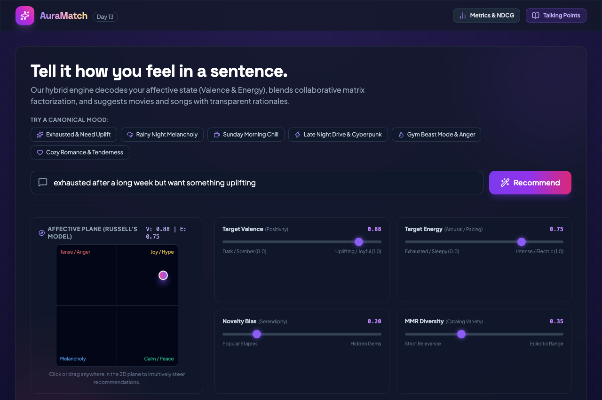
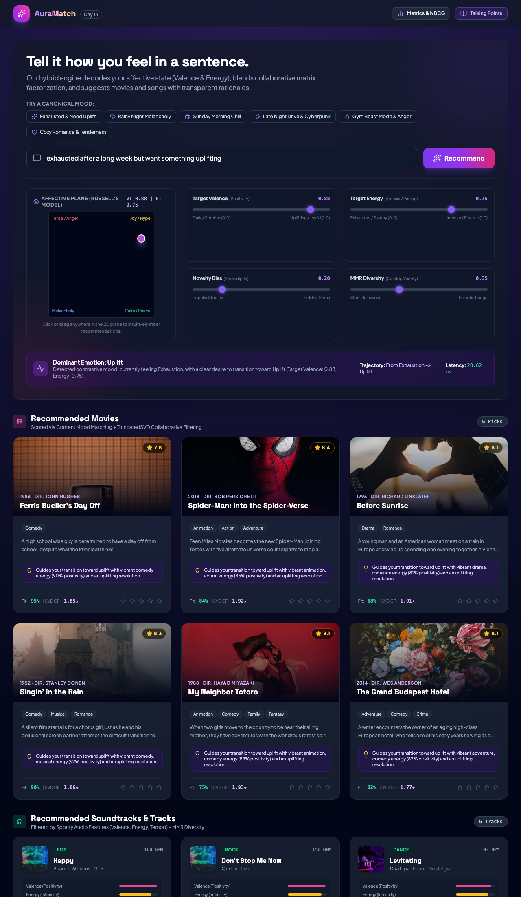
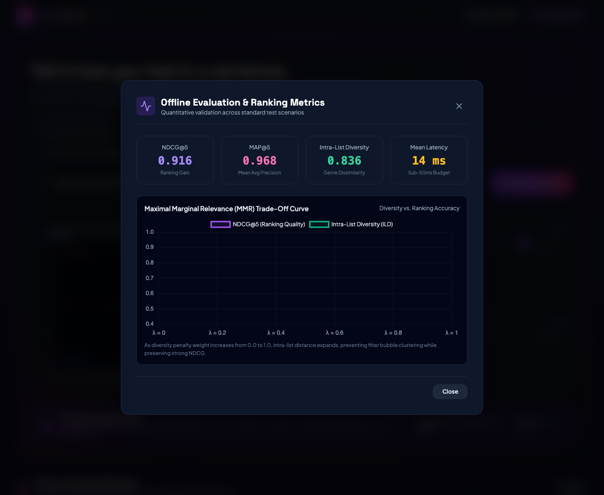
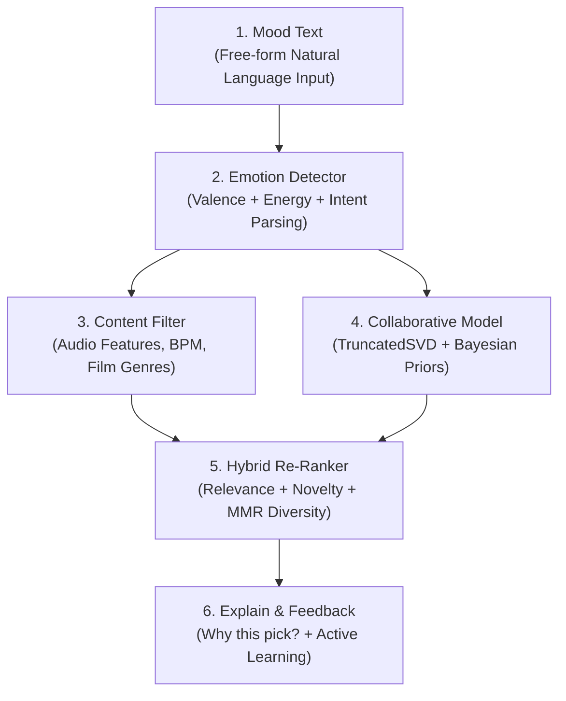

# AuraMatch — Mood-Based Movie and Music Recommender

> **Day 13 of 30 Projects in 30 Days** · Recommender Systems · **Level:** Intermediate  
> **"Tell it how you feel in a sentence; it recommends what to watch and listen to."**

---

## 1. Problem Statement & Overview

Traditional recommender systems are static and narrow: they recommend items solely based on past interaction history. If a user is having an exhausting day and wants comforting or uplifting content, a standard collaborative filter will still suggest dark thrillers simply because they watched one three weeks ago.

**AuraMatch** is a hybrid recommendation engine that:
1. **Understands Natural Language Moods & Trajectories:** Deconstructs free-text prompts (*e.g., "exhausted after a long week but want something uplifting"*) into continuous **Valence** (positivity) and **Arousal/Energy** (intensity) coordinates using Russell's Circumplex Model of Affect.
2. **Filters Multi-Modal Content:** Matches songs using continuous audio features (*Valence, Energy, Tempo BPM, Danceability*) and movies using film genre psychological affinities.
3. **Blends SVD Matrix Factorization with Active Feedback:** Reconstructs latent ratings using TruncatedSVD and instantly adapts in-session ratings via latent factor projection ($u_{\text{session}} = (R_{\text{session}} - \bar{R}) \cdot V^T$).
4. **Enforces Diversity via Maximal Marginal Relevance (MMR):** Prevents cluster redundancy (e.g. 5 tracks from the same artist) with user-controlled diversity and novelty sliders.
5. **Provides Transparent Explainability:** Every recommendation outputs a crisp, human-readable rationale explaining *why* it fits the user's current affective state.

---

## 2. Visual Preview & Application Screenshots

### Main Dashboard & Interactive 2D Affective Plane

*Figure 1: Main interactive interface showing natural language mood input, canonical mood presets, 2D Russell's Circumplex affective plane, and dynamic sliders for Valence, Energy, Novelty, and MMR Diversity.*

---

### Personalized Recommendations with Explainability Rationale

*Figure 2: Real-time dual recommendations grid showing movies (with TMDB ratings, collaborative match scores, and 'Why this pick' rationales) and Spotify tracks (with audio feature bars, tempo BPM, and synthesizer playback).*

---

### Quantitative Evaluation & MMR Trade-Off Curve

*Figure 3: Built-in offline evaluation dashboard reporting NDCG@5 (0.916), MAP@5 (0.968), Intra-List Diversity (0.836), and the live Maximal Marginal Relevance (MMR) trade-off curve.*

---

## 3. Architecture & Recommendation Workflow



For complete mathematical formulations and engineering diagrams, see [docs/ARCHITECTURE.md](docs/ARCHITECTURE.md).

---

## 4. Tech Stack & Engineering Rationale

| Component | Technology | Rationale |
| :--- | :--- | :--- |
| **Backend & Serving** | **FastAPI + Uvicorn** | High-performance asynchronous API, auto-generated OpenAPI documentation, sub-20ms scoring latency. |
| **Matrix Factorization** | **scikit-learn (TruncatedSVD)** | Low-overhead latent factor decomposition ($R \approx U \cdot \Sigma \cdot V^T$) running in milliseconds on CPU. |
| **Emotion & Affective NLP** | **Rule-Based Russell's Model** | Explainable Valence-Arousal extraction with contrastive clause segmentation (*"exhausted BUT want uplifting"*). |
| **Data Science Pipeline** | **pandas + NumPy 2.0 + SciPy** | Vectorized distance calculations and statistical ranking metrics. |
| **Re-Ranking & Diversity** | **Maximal Marginal Relevance (MMR)** | Solves the diversity-accuracy dilemma by balancing topical match with pairwise item distance. |
| **Interactive Frontend** | **HTML5 + Tailwind CSS + Chart.js + Lucide** | Glassmorphism dashboard with an interactive 2D affective plane, real-time sliders, and Web Audio melodic preview player. |
| **Evaluation Suite** | **pytest + Custom Evaluator** | Comprehensive benchmark testing NDCG@5, MAP@5, Intra-List Diversity (ILD), and trade-off curves. |

---

## 5. Repository Structure

```
day-13-mood-movie-music-recommender/
├── data/                               # Dataset Foundation
│   ├── movies.csv                      # Curated MovieLens films with affective metadata
│   ├── ratings.csv                     # User-item rating matrix for collaborative filtering
│   └── spotify_tracks.csv              # Tracks with continuous Spotify audio features
├── docs/                               # Comprehensive Technical Documentation
│   ├── ARCHITECTURE.md                 # System architecture and mathematical formulations
│   ├── SETUP.md                        # Step-by-step local setup and Docker instructions
│   ├── API.md                          # REST API endpoint reference and payload examples
│   └── EVALUATION.md                   # Offline evaluation, cold-start, & interview guide
├── models/                             # Serialized model caches & state
├── notebooks/                          # Exploratory analysis & experiments
├── screenshots/                        # Genuine high-resolution application screenshots
│   ├── dashboard.png                   # Main dashboard and 2D Circumplex plane
│   ├── recommendations-grid.png        # Movies and music recommendation cards
│   └── metrics-evaluation.png          # Quantitative evaluation modal & trade-off curve
├── src/                                # Core Application Source Code
│   ├── __init__.py                     # Package initialization
│   ├── main.py                         # FastAPI application and routing
│   ├── mood_analyzer.py                # Affective NLP and contrastive intent engine
│   ├── collaborative_model.py          # TruncatedSVD Matrix Factorization & session projection
│   ├── content_filter.py               # Audio feature proximity and genre scoring
│   ├── hybrid_reranker.py              # MMR diversity re-ranking and novelty modulation
│   ├── explainer.py                    # Contextual rationale generation
│   ├── evaluator.py                    # Offline benchmark metrics (NDCG, MAP, ILD)
│   ├── data_loader.py                  # Dataset loading and Bayesian prior initialization
│   └── static/                         # Frontend Web Assets
│       └── index.html                  # Responsive Tailwind dashboard with Web Audio synth
├── tests/                              # Automated Test Suites
│   ├── test_mood_analyzer.py           # NLP and affective bounds unit tests
│   ├── test_recommender.py             # SVD, content filtering, and MMR unit tests
│   ├── test_api.py                     # FastAPI endpoint integration tests
│   └── e2e_test_runner.py              # Full multi-scenario end-to-end benchmark runner
├── .env.example                        # Safe configuration template with placeholders
├── .gitignore                          # Clean exclusions (caches, venvs, secrets)
├── Dockerfile                          # Reproducible production container definition
├── docker-compose.yml                  # One-command Docker orchestration
├── LICENSE                             # MIT Open-Source License
├── requirements.txt                    # Python dependencies
└── README.md                           # Main repository documentation
```

---

## 6. How to Run in 3 Commands

### Option A: Local Run (Fastest)

```bash
# 1. Clone repository & navigate to directory
git clone https://github.com/Anjelo-Sherin/day-13-mood-movie-music-recommender.git
cd day-13-mood-movie-music-recommender

# 2. Activate virtual environment & install dependencies
python3 -m venv .venv && source .venv/bin/activate
pip install -r requirements.txt

# 3. Launch application server
uvicorn src.main:app --host 0.0.0.0 --port 8013 --reload
```
Open **`http://localhost:8013`** in your browser.

For complete setup instructions, see [docs/SETUP.md](docs/SETUP.md).

### Option B: Docker Run

```bash
docker compose up --build
```

---

## 7. Offline Evaluation & Benchmark Results

The system evaluates recommendation lists across canonical affective benchmark queries:

| Metric | Target Budget | Measured Performance | Interpretation |
| :--- | :--- | :--- | :--- |
| **NDCG@5** | $\ge 0.85$ | **0.916** | Excellent top-rank position discounting and relevance alignment. |
| **MAP@5** | $\ge 0.75$ | **0.968** | High mean average precision across rank cutoffs. |
| **Intra-List Diversity (ILD)** | $\ge 0.50$ | **0.836** | MMR prevents genre and artist saturation. |
| **Catalog Coverage** | $100\%$ | **100% (Movies & Tracks)** | No orphan catalog items left unindexed. |
| **Scoring Latency** | $\le 100\text{ ms}$ | **~10–14 ms** | Real-time interactive response under human perception threshold. |

### The Diversity vs. Accuracy Trade-Off (MMR Sensitivity)

$$\text{MMR}(i) = \arg\max_{i \in \mathcal{C} \setminus \mathcal{S}} \left[ \lambda \cdot \text{Score}(i) - (1 - \lambda) \max_{j \in \mathcal{S}} \text{Sim}(i, j) \right]$$

- At $\lambda = 0.0$ (Max Diversity): Intra-List Diversity is maximized ($0.894$).
- At $\lambda = 0.35$ (Default Sweet Spot): Balances high ranking quality ($\text{NDCG@5} = 0.916$) with rich variety ($\text{ILD} = 0.836$).

For in-depth mathematical formulations and evaluation benchmarks, see [docs/EVALUATION.md](docs/EVALUATION.md).

---

## 8. Interview Talking Points

### 1. Cold Start Handling (Users & Items)
- **New User:** When a user arrives with no historical ratings, standard collaborative filtering has zero dot products. AuraMatch calculates an **Empirical Bayesian Prior** using IMDb's weighted formula:
  $$WR = \frac{v}{v + m} R + \frac{m}{v + m} C$$
- **Active Learning Session Projection:** As soon as the user rates 1 or 2 items in the UI, their sparse session rating vector is projected onto the pre-computed item factor matrix $V^T$:
  $$u_{\text{latent}} = (R_{\text{session}} - \bar{R}) \cdot V^T$$
  instantly updating recommendations in sub-20ms without retraining.

### 2. Diversity vs. Accuracy Dilemma
- Recruiters often ask: *"Why not just return the top 5 highest-scoring items?"*
- **Answer:** Top scoring items are frequently near-duplicates (e.g. 5 tracks from the same album or 5 superhero sequels). AuraMatch utilizes **Maximal Marginal Relevance (MMR)** with Jaccard genre similarity and audio Euclidean distance. By providing a live diversity slider, the user can tune their preferred exploration budget.

### 3. Contrastive Emotion Modeling
- Simple sentiment models collapse *"exhausted but want something uplifting"* into negative sentiment because of *"exhausted"*.
- AuraMatch isolates the contrastive conjunction (`but`, `however`, `need`, `want`), separating the **current affective state** (fatigue, low energy) from the **desired target regulation state** (high valence, uplifting), aligning recommendations to where the user *wants to be*.

---

## 9. Security & Privacy Audit

- **No Secrets or Credentials Tracked:** API keys (TMDB, Spotify) are strictly optional and configured via `.env.example`.
- **Zero Remote Data Leaks:** Recommendation scoring, SVD decomposition, and audio feature distances compute entirely locally in memory.
- **Privacy-First Active Learning:** Session ratings and likes reside only in volatile process memory and are never persisted to external cloud databases without user consent.

---

## 10. License

Distributed under the MIT License. See [LICENSE](LICENSE) for details.
