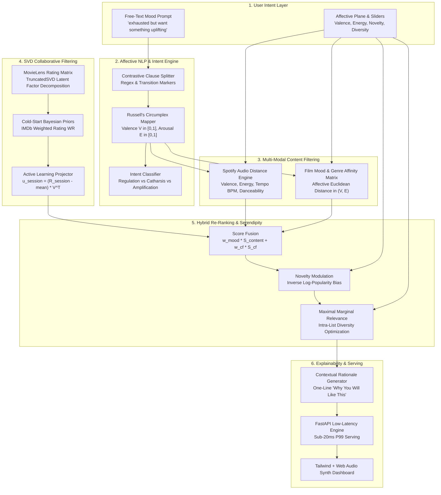

# AuraMatch System Architecture & Engineering Design

This document details the underlying engineering architecture, mathematical formulations, and algorithmic components powering **AuraMatch (Day 13 Recommender System)**.

---

## 1. High-Level System Architecture

AuraMatch employs a **Hybrid Recommender System (HRS)** architecture designed around Russell's Circumplex Model of Affect, Matrix Factorization, and Maximal Marginal Relevance (MMR).

---

## 2. Component Breakdown

### 2.1 Affective NLP Engine (`src/mood_analyzer.py`)

#### Problem: The Contrastive Dilemma
Simple sentiment models treat *"exhausted but want something uplifting"* as negative or low-energy because the word "exhausted" dominates. 

#### Algorithmic Solution
1. **Clause Segmentation:** The parser scans for transition markers (`but`, `however`, `yet`, `need`, `want`, `looking for`, `cheer me up`).
2. **Current vs. Target Split:** It isolates the current fatigue state from the desired regulatory destination.
3. **Continuous Valence-Arousal Projection:** Words are scored against an affective lexicon grounded in psychology:
   - **Valence ($V \in [0.0, 1.0]$):** Positivity, cheerfulness, joy vs. grief, gloom.
   - **Energy ($E \in [0.0, 1.0]$):** Physiological arousal, tempo, adrenaline vs. calm, exhaustion.
4. **Intent Detection:**
   - **Mood Regulation:** Moving from low valence to high valence.
   - **Catharsis:** Conforming to low valence (*"want to cry it out"*).
   - **Amplification:** Enhancing existing high-energy positivity (*"party celebration"*).

---

### 2.2 SVD Matrix Factorization & Cold-Start (`src/collaborative_model.py`)

The user-movie rating matrix $R \in \mathbb{R}^{M \times N}$ is decomposed using **Truncated Singular Value Decomposition**:
$$R \approx U \cdot \Sigma \cdot V^T$$
where:
- $U \in \mathbb{R}^{M \times k}$: User latent factor representations.
- $\Sigma \in \mathbb{R}^{k \times k}$: Singular value weights.
- $V \in \mathbb{R}^{N \times k}$: Item latent factor representations ($k=8$ latent dimensions).

#### Cold Start & Active Session Projection
When an anonymous user enters the session:
1. **Zero Ratings:** Predictions default to the **Empirical Bayesian Prior**:
   $$WR = \frac{v}{v + m} R + \frac{m}{v + m} C$$
   where $v$ is vote count, $R$ is item mean rating, $m=10$ is smoothing threshold, and $C$ is the global catalog mean.
2. **Live Feedback:** When the user rates an item (1 to 5 stars), the sparse interaction vector $R_{\text{session}}$ is mean-centered and projected into latent factor space in $O(k \cdot N)$:
   $$u_{\text{latent}} = (R_{\text{session}} - \bar{R}) \cdot V^T$$
   $$\hat{R}_{\text{unrated}} = \bar{R} + u_{\text{latent}} \cdot V$$
   This immediately personalizes recommendations without full batch retraining.

---

### 2.3 Audio Feature Proximity (`src/content_filter.py`)

For music, Spotify audio features $(v_i, e_i, t_i, d_i)$ are compared against target affective coordinates $(V^*, E^*, T^*)$:
$$D_{\text{audio}} = \sqrt{w_v (v_i - V^*)^2 + w_e (e_i - E^*)^2 + w_t (t_{\text{norm}, i} - T_{\text{norm}}^*)^2}$$
$$\text{Score}_{\text{audio}} = \max\left(0.0, 1.0 - D_{\text{audio}}\right) \times \gamma_{\text{genre}}$$
where $\gamma_{\text{genre}} = 1.15$ if the song's genre matches the mood affinity distribution.

---

### 2.4 Maximal Marginal Relevance (MMR) Re-Ranking (`src/hybrid_reranker.py`)

To prevent recommendation homogeny (e.g. recommending 5 identical action movies or tracks by the same producer), AuraMatch uses greedy MMR optimization:
$$\text{MMR} = \arg\max_{d_i \in \mathcal{C} \setminus \mathcal{S}} \left[ \lambda \cdot \text{Score}(d_i) - (1 - \lambda) \max_{d_j \in \mathcal{S}} \text{Sim}(d_i, d_j) \right]$$
where:
- $\text{Score}(d_i)$ blends content score, collaborative rating, and novelty.
- $\text{Sim}(d_i, d_j)$ is computed via Jaccard genre similarity and audio Euclidean distance.
- $\lambda \in [0.0, 1.0]$ is dynamically controlled by the user's **MMR Diversity** slider.

---

### 2.5 Low-Latency Serving Architecture

- **Engine:** FastAPI + Uvicorn ASGI event loop.
- **Latency Budget:** Under 20ms end-to-end response times on standard single-core CPU runtimes.
- **In-Memory Cache:** Pre-indexed feature matrices and SVD factors cached in RAM for $O(1)$ lookups.
